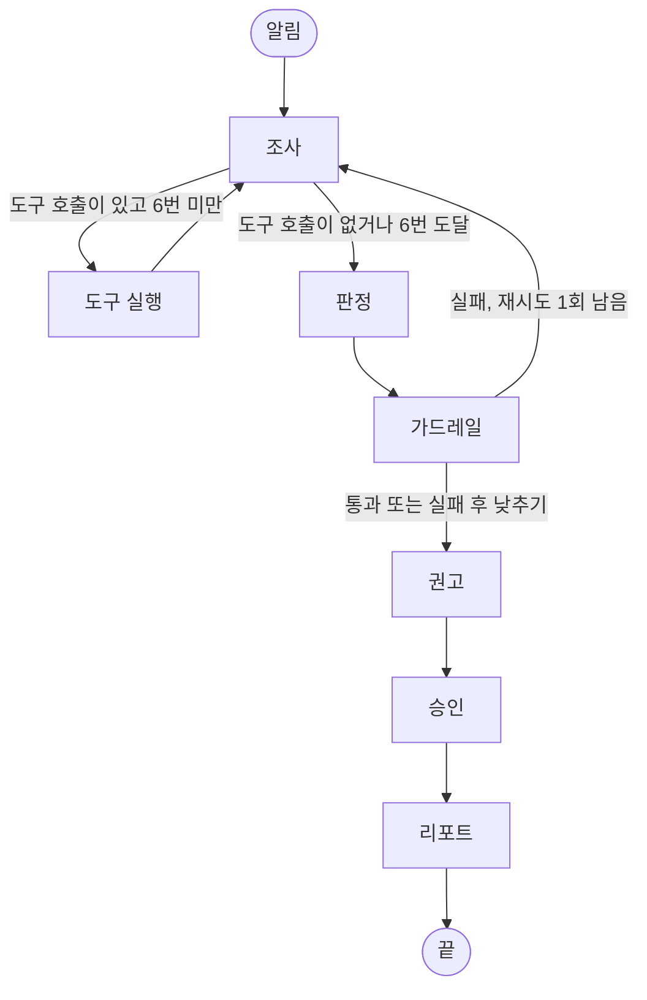

# 아키텍처

> 1일차에 화이트보드로 함께 그린 설계도를 옮깁니다. 출발점은 01 문서 5장의 그림(①~⑤)과 01b 문서의 부품 표입니다.
>
> **v1 초안:** `state.py`, `nodes.py`, `guardrail.py`와 `config.py`의 기본값을 읽고 📘이 먼저 채웠습니다. 화이트보드에서 함께 확정합니다.

## 1. 에이전트 설계도

`python -m soc.agent.graph`로 실제 그래프를 출력할 수 있게 되면(AG-3 이후) 위 그림을 그 출력으로 바꿉니다.

### 상태 (TriageState)
| 칸 | 담는 것 | 쓰는 노드 |
|---|---|---|
| `alert` | 들어온 알림 (host, pid, title, rule_id, event_ids 등) | 입력 |
| `messages` | 조사 대화 (LLM ⇄ 도구) | 조사, 도구 실행, 가드레일(재조사 요청) |
| `seen_event_ids` | 도구로 실제 조회한 기록의 `event_id` | 도구 실행 |
| `tool_rounds` | 도구를 부른 횟수 | 도구 실행 |
| `verdict` | 판정 (악성/의심/정상, 신뢰도, 기법, 근거 `event_id`, 이유) | 판정, 가드레일(낮추기) |
| `guardrail`, `guardrail_log`, `guardrail_retries` | 검증 결과, 검사 기록, 재시도 횟수 | 가드레일 |
| `playbook` | 검색한 플레이북 조각 (`source`, `page`, `text`, `score`) | 권고 |
| `recommendation` | 권고 조치 목록과 요약 | 권고 |
| `approval` | 승인 필요 여부와 사람의 결정 | 승인 |
| `trace` | 지나온 경로 | 모든 노드 |
| `usage` | 토큰 사용량 (비용 계산) | 조사, 판정, 권고 |
| `report` | 최종 리포트 | 리포트 |

### 노드
| 노드 | 하는 일 | 읽는 상태 | 쓰는 상태 | 쓰는 도구 | 운전 |
|---|---|---|---|---|---|
| 조사 | LLM이 조사 도구 중 무엇을 부를지 정함 | `alert`, `messages` | `messages`, `trace`, `usage` | 🔍 조사 도구(`get_process_tree`, `get_process_activity`, `get_host_timeline`) | 📘 |
| 도구 실행 | 요청된 도구를 실행하고 결과의 `event_id`를 실제 조회한 기록으로 남김. 도구 오류도 LLM에게 알림 | `messages` | `messages`, `seen_event_ids`, `tool_rounds`, `trace` | 위와 같음 | |
| 판정 | 대화를 보고 악성/의심/정상 판정 (정해진 형식으로 출력) | `messages` | `verdict`, `trace`, `usage` | | |
| 가드레일 | 인용한 근거가 실제 조회한 기록인지, 악성에 서로 다른 근거가 2개 이상인지 기계적으로 검증 | `verdict`, `seen_event_ids`, `alert` | `guardrail`, `guardrail_log`, `guardrail_retries`, `messages`, `verdict`, `trace` | | 📘 |
| 권고 | 알림 제목과 판정(기법)으로 플레이북을 검색해 권고 조치와 승인권자 정함 | `alert`, `verdict` | `playbook`, `recommendation`, `trace`, `usage` | 📘 `search_playbook` | 🔍 |
| 승인 | 위험한 조치가 있으면 멈추고 사람의 결정을 기다림 | `recommendation` | `approval`, `trace` | | 🔍 |
| 리포트 | 판정, 근거, 권고, 출처, 경로, 비용을 모아 저장 | 거의 전부 | `report`, `trace` | | |

## 2. 갈림길
| 질문 | 초안 | 근거 |
|---|---|---|
| 조사 후 도구를 더 부를까, 판정으로 갈까? 최대 몇 번? | LLM이 도구 호출을 요청하고 `tool_rounds`가 6 미만이면 도구 실행, 아니면 판정 | `config.py`의 `max_tool_rounds=6`. 타임라인이 `truncated`로 잘렸을 때 범위를 줄여 다시 부르는 것도 이 횟수 안에서 한다 |
| 가드레일이 실패하면 다시 조사할까, 판정을 낮출까? | 처음 1번은 부족한 점을 알려 주고 다시 조사. 그래도 실패하면 지어낸 근거를 빼고 악성을 '의심'으로 낮추고 사람 검토 표시(`needs_review`) | `guardrail_on_fail="retry"`, `max_guardrail_retries=1`. 2일차 `DECISIONS.md` "가드레일 실패 처리"에서 다시 정함 |
| 권고에 위험한 조치가 있으면 승인에서 멈출까? | 멈춘다. 위험한 조치는 `isolate_host`, `block_ip`, `kill_process`, `reset_password`. 위험한 조치가 없으면 승인 없이 리포트로 | `state.py`의 `DANGEROUS_ACTIONS`, 01번 정책 PDF 2장. 승인은 2일차(H-1)에 구현 |

## 3. 배포 구성도 (2일차부터)
<!-- 01b 문서 2장의 그림을 실제 리소스(Deployment, StatefulSet, Job, Service, Ingress, Secret, ConfigMap)로 바꿔 그리기 -->
