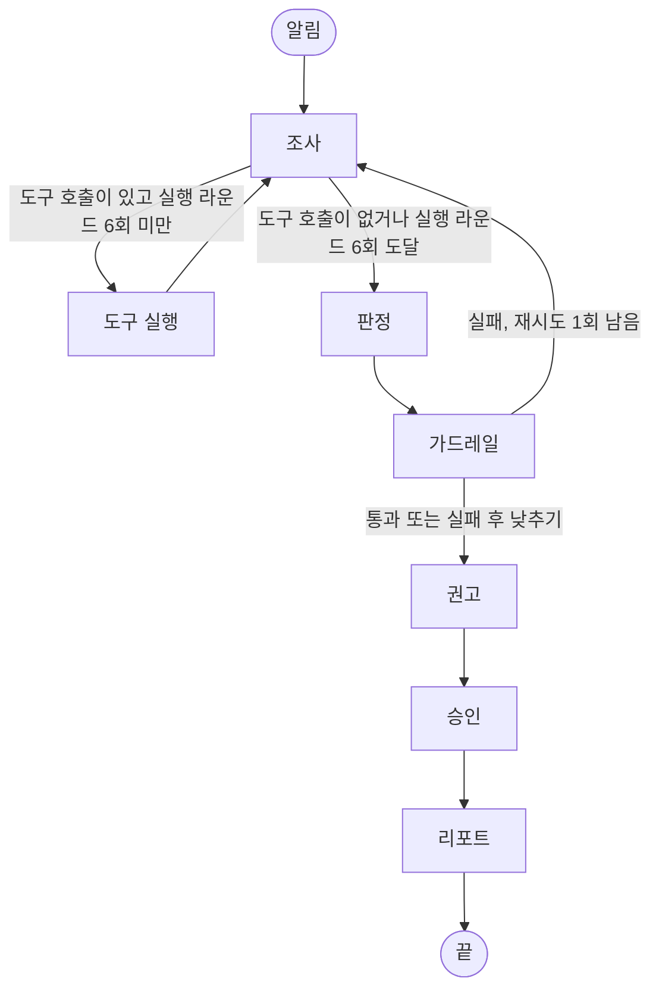

# 아키텍처

> 1일차에 화이트보드로 함께 그린 설계도를 옮깁니다. 출발점은 01 문서 5장의 그림(①~⑤)과 01b 문서의 부품 표입니다.
>
> **v1 초안:** `state.py`, `nodes.py`, `guardrail.py`와 `config.py`의 기본값을 읽고 📘이 먼저 채웠습니다. 화이트보드에서 함께 확정합니다.

### 구현 상태와 설계 범위
- **완료:** REC-1~4(이벤트 매핑·조사 도구). 실제 OpenSearch 2.17.1에서 조사 도구 테스트 8개를 통과했고, 다른 PC의 동일 PID 분리와 부모 기록 누락 설명을 확인했습니다.
- **1일차 후속 구현:** 조사 노드(AG-1), 권고 노드(AG-2), 그래프 연결(AG-3). 아래 흐름도는 연결할 설계이며 전체 에이전트 실행 완료를 뜻하지 않습니다.
- **2일차 구현:** 가드레일 핵심 검사(G-1~2), 사람 승인(H-1) 등. 현재 가드레일 검사 함수는 빈 문제 목록을 반환하고, 승인 노드는 `not_implemented` 상태를 반환합니다.
- **1일차 뼈대 검증:** 가짜 도구(`TELEMETRY_TOOLS=mock`, `KB_TOOLS=mock`)와 가짜 LLM(`FAKE_LLM=true`)으로 흐름을 확인합니다. 실제 도구 연결은 2일차에 전환·검증합니다.

## 1. 에이전트 설계도

`python -m soc.agent.graph`로 실제 그래프를 출력할 수 있게 되면(AG-3 이후) 위 그림을 그 출력으로 바꿉니다.

### 상태 (TriageState)
| 칸 | 담는 것 | 쓰는 노드 |
|---|---|---|
| `alert` | 들어온 알림 (host, pid, title, rule_id, event_ids 등) | 입력 |
| `messages` | 조사 대화 (LLM ⇄ 도구) | 조사, 도구 실행, 가드레일(재조사 요청) |
| `seen_event_ids` | 도구 결과에서 수집한 `event_id` (mock 모드에서는 견본 기록 ID) | 도구 실행 |
| `tool_rounds` | 도구 실행 라운드 수. `run_tools()` 1회 실행 시 1 증가하며 한 라운드에 여러 도구 호출이 포함될 수 있음 | 도구 실행 |
| `verdict` | 판정 (악성/의심/정상, 신뢰도, 기법, 근거 `event_id`, 이유) | 판정, 가드레일(낮추기) |
| `guardrail`, `guardrail_log`, `guardrail_retries` | 검증 결과, 검사 기록, 재시도 횟수 | 가드레일 |
| `playbook` | 검색한 플레이북 조각 (`source`, `page`, `text`, `score`) | 권고 |
| `recommendation` | 권고 조치 목록과 요약 | 권고 |
| `approval` | 승인 필요 여부와 사람의 결정 | 승인 |
| `trace` | 지나온 경로 | 모든 노드 |
| `usage` | 토큰 사용량 (비용 계산) | 조사, 판정, 권고 |
| `report` | 최종 리포트 | 리포트 |

### 노드
| 노드 | 하는 일 | 읽는 상태 | 쓰는 상태 | 쓰는 도구 | 운전 |
|---|---|---|---|---|---|
| 조사 | LLM이 조사 도구 중 무엇을 부를지 정함 | `alert`, `messages` | `messages`, `trace`, `usage` | 🔍 조사 도구(`get_process_tree`, `get_process_activity`, `get_host_timeline`) | 📘 |
| 도구 실행 | 선택된 모드의 도구를 실행하고 결과의 `event_id`를 `seen_event_ids`에 수집. 도구 오류는 `error` 결과로 LLM에게 전달 | `messages` | `messages`, `seen_event_ids`, `tool_rounds`, `trace` | 위와 같음 | |
| 판정 | 대화를 보고 악성/의심/정상 판정 (정해진 형식으로 출력) | `messages` | `verdict`, `trace`, `usage` | | |
| 가드레일 | 인용한 근거가 도구 결과의 `seen_event_ids` 또는 알림의 `event_ids`에 있는지, 악성에 서로 다른 근거가 2개 이상인지 검사하도록 구현 예정 | `verdict`, `seen_event_ids`, `alert` | `guardrail`, `guardrail_log`, `guardrail_retries`, `messages`, `verdict`, `trace` | | 📘 |
| 권고 | 알림 제목과 판정(기법)으로 플레이북을 검색해 권고 조치와 승인권자 정함 | `alert`, `verdict` | `playbook`, `recommendation`, `trace`, `usage` | 📘 `search_playbook` | 🔍 |
| 승인 | 위험한 조치가 있으면 멈추고 사람의 결정을 기다림 | `recommendation` | `approval`, `trace` | | 🔍 |
| 리포트 | 판정, 근거, 권고, 출처, 경로, 비용을 모아 저장 | 거의 전부 | `report`, `trace` | | |

### 조사 도구와 저장소 연결
- 실제 모드: 알림의 `host`·`pid`·`ts` → 조사 노드의 도구 선택 → REC-2~4 → OpenSearch의 `edr-events-*` 조회 → 요약된 기록과 `event_id`를 도구 실행 노드에 반환합니다. 인덱스 접두어는 `INDEX_EVENTS` 설정을 따릅니다.
- 조사 도구는 프로세스 조회에 `host`와 PID를 함께 사용합니다. 부모·자식은 REC-2, 통신·파일 등의 후속 활동은 REC-3, PC의 시간 범위 조회는 REC-4가 담당합니다.
- 테스트는 `test-edr-events-*`를 사용해 실습 기록과 분리합니다. mock 모드는 OpenSearch를 조회하지 않고 견본 결과를 반환합니다.
- 도구 실행 노드는 반환된 근거 ID를 모으고, 가드레일은 그 ID와 알림에 포함된 근거 ID를 판정에 인용된 ID와 비교하도록 구현합니다.

### 도구 결과를 해석하는 규칙
다음은 에이전트 연결 시 적용하고 검증할 규칙입니다. 도구가 해당 필드를 반환하는 것과 LLM이 올바르게 해석하는 것은 별도로 확인합니다.

| 결과 | 뜻 | 에이전트가 할 일 |
|---|---|---|
| `events: []` | 요청한 PC·프로세스·시간 범위에 맞는 기록을 찾지 못함 | 빈 결과만으로 정상 판정하지 않고 조회 조건과 근거 부족 여부 확인 |
| `process: None`, `note` | 대상 프로세스의 실행 기록을 찾지 못함 | 실행하지 않았다고 단정하지 않고 기록 누락 사유를 판정에 반영 |
| 부모 누락 `note` | 부모 번호는 있으나 해당 부모의 실행 기록을 찾지 못함 | 찾은 조상까지만 사용하고, 부모가 실제로 없다고 단정하지 않음 |
| `error` | 도구 실행 또는 검색 실패. `run_tools()`가 예외를 결과로 변환해 전달 | 기록 없음과 구분하고 오류 정보를 확인. 조회 실패를 정상 근거로 사용하지 않음 |
| `truncated: True` | 타임라인의 일치 기록이 100건을 넘어 일부만 반환됨 | 필요한 경우 시간 범위를 줄여 재조회. 추가 호출도 전체 실행 라운드 제한을 따름 |

## 2. 갈림길
| 질문 | 초안 | 근거 |
|---|---|---|
| 조사 후 도구를 더 실행할까, 판정으로 갈까? 최대 몇 라운드? | LLM이 도구 호출을 요청하고 `tool_rounds`가 6 미만이면 도구 실행, 아니면 판정 | `config.py`의 `max_tool_rounds=6`. 타임라인이 `truncated`로 잘렸을 때 범위를 줄여 다시 부르는 것도 이 라운드 제한 안에서 한다. 개별 도구 호출 개수의 상한을 뜻하지는 않음 |
| 가드레일이 실패하면 다시 조사할까, 판정을 낮출까? | 처음 1번은 부족한 점을 알려 주고 다시 조사. 그래도 실패하면 지어낸 근거를 빼고 악성을 '의심'으로 낮추고 사람 검토 표시(`needs_review`) | `guardrail_on_fail="retry"`, `max_guardrail_retries=1`. 2일차 `DECISIONS.md` "가드레일 실패 처리"에서 다시 정함 |
| 권고에 위험한 조치가 있으면 승인에서 멈출까? | 멈춘다. 위험한 조치는 `isolate_host`, `block_ip`, `kill_process`, `reset_password`. 위험한 조치가 없으면 승인 없이 리포트로 | `state.py`의 `DANGEROUS_ACTIONS`, 01번 정책 PDF 2장. 승인은 2일차(H-1)에 구현 |

### 확정: 재조사를 포함해 전체 6라운드 제한 유지
- 최초 조사와 가드레일 실패 후 재조사를 합쳐 도구 실행은 **전체 최대 6라운드**로 제한합니다. 재조사 때 `tool_rounds`를 초기화하지 않으며 별도 예산도 추가하지 않습니다.
- 남은 라운드가 있으면 그 범위 안에서 추가 도구를 실행할 수 있습니다. 이미 6라운드를 사용했다면 조사 노드로 돌아가더라도 추가 도구 실행 없이 기존 근거와 가드레일의 지적을 바탕으로 다시 판정합니다.
- 가드레일 재시도는 최대 1회입니다. 재판정도 검증에 실패하면 잘못된 근거를 제외하고 악성 판정을 '의심'으로 낮추며 사람 검토 표시(`needs_review`)를 남깁니다.
- 6회는 개별 도구 호출 수가 아니라 `run_tools()` 실행 라운드 수입니다. 한 라운드에는 여러 도구 호출이 포함될 수 있습니다.
- 현재 코드의 누적 라운드 처리와 상한을 유지합니다. 가드레일 구현 단계에서 한도 도달 후 재조사 시 추가 도구가 실행되지 않는지 테스트합니다.

## 3. 배포 구성도 (2일차부터)
<!-- 01b 문서 2장의 그림을 실제 리소스(Deployment, StatefulSet, Job, Service, Ingress, Secret, ConfigMap)로 바꿔 그리기 -->
